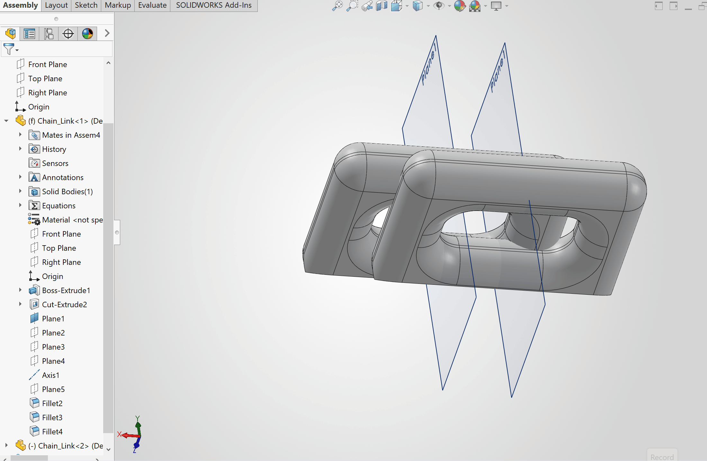

# Lab 8 - Design and Print Something Useful

## Why Asking Smart Questions Matter
Asking smart questions matter because it allows you to actually understand the problem instead of just immediately trying to create a solution. When designing something, it is very easy to see a problem and start making a solution based on what you think the problem is, however, this can lead to solving the wrong problem entirely. Asking questions allows you to find the root of the problem, understand the people involved, and figure out what is actually needed. The article explains that designers are similar to detectives since they need to gather information from different sources and use questions to figure out what is actually going on. Additionally, good questions can challenge assumptions that people may have already made and can cause people to think about different possibilities that they may not have considered before. This is especially important since a quick solution is not always the best solution, and asking questions can help prevent time and resources from being wasted on something that does not actually solve the problem. Overall, asking smart questions is important because it allows for a better understanding of the situation, while also helping create new ideas and better designs through collaboration and deeper thinking.

## Problem Statement
For school, I use a Windows Surface book laptop since I can use a "pen" to write things down and solve problems without having to use a ton of papers and keep track of them with folders. The problem is that I am a forgetful person and it is really easy for me to lose pen and pencil shaped objects (God knows how many I have lost in my life time). Originally, I had a case for my laptop with a place to hold the pen, but I forgot many times to put it back and the holder stopped working over time. These pens are a pretty penny, so I have been trying to find a product to permanently attach the pen to the laptop, but the weird shape and size of it gave me a dead end. I have been thinking about it for months, so this lab was the perfect opportunity to create my own.

## Design 
### Approach
Due to a lack of time, the approach to design the chains was to overengineer them to do little to no math. While the attachment to the pen would be more precise due to trying to minimize the size of the attachment (which due to the overengineering of the chains made it larger than I had hoped). 
### An Individual Chain
#### Choosing the General Dimensions of Individual Chain
The dimension that will most affect the rest of the project is the thickness of a chain. Since this will be connected to the laptop that goes into my backpack, I had to take into consideration the backpack slamming the ground with a ton of books in it. Therefore, I needed the chain to be thick enough to possibly take a large impact while not too large enough to be obscenely big. Using my caliper, I decided on a 8.5 mm thickness. This will be a print in place chain, so I also need to take into account gaps between each chain via their thickness and that they so do not interact with one another. Also, the pair of "male" chains connecting to the one "female" chain (all act as both) need to have as little interaction inside of the female, to ensure they are easily able to move around. To ensure that two chains in a row do not infuse with one another, I set a hardline distance of 1.2mm on each gap from one another. I was unsure how big to make the gap between the two male chains, so I decided to chose 4mm base on observations of the finished chain and I would adjust it later if it would not work (luckily, this worked on the first try). Lastly, I needed to decide on an angle at which each chain will interlock with one another. To reduce any and all necessary adjustments or the like, I decided that a 45 degree angle would be perfect to keep things symmetrical. Additional, putting it at a 45 degree angle would greatly reduce the amount of support needed.

#### Creating the Equations
The equations were easy to make. Since a pair of chains on the width side of the female chain (male and female connection) will basically create 3 layers of thickness with the additional 1.2mm gap on each side. The parameter equation simply needs to be 3 times the thickness plus 2 time 1.2mm. When looking along the length, there will be two male chains and one female that connects them. So each male has one of their thicknesses inside the female, and to ensure they do not fall out the female needs two thicknesses as well. Additionally, there is the variable gap between males. So the equation for the length of a chain must be 4 times the thickness plus the gap (which I chose to be 4mm). Lastly, I also created an angle variable, however, it was later unnecessary since a 45 degree angle would work in nearly all cased.

#### Creating the Base of an Individual Chain
##### Sketch
To do so, I simply created two concentric rectangles. For the larger rectangle, I set its sides to the length and width equations. Then, since I incorporated the desired gap at the center with-in the earlier equations, I simply had the internal rectangle have each of its sides a thickness length away from the external rectangle's equivalent sides.

##### Extrusion
The extrusion was simple, I simply had to extrude it by my chosen thickness.

#### Cutting Flat Side for Print Bed
##### Sketch
Since the chains will be put at an angle, I am required to cut one corner to create a flat side for the chain to rest on that would allow the chain to generally print at 90 degrees. Furthermore, due to how the chains connected to one another, I had to pick a corner of one of the lengths. To do so, I simply created a triangle at a corner with variable sides except I chose the hypotenuse to be locked at 6mm. I chose 6 mm so that each chain would have a good amount of surface area with the print bed. Next, I simply angled the hypotenuse in a way that that would allow the chain to be angled at 45 degrees from the print bed.

##### Cut Extrusion
To finish this, I simply cut all the way to the other side of the chain

#### Giving Curvature
The last edit to the chain was to give it curavture on all the sharp edges. This will allow the chains to move around more freely instead of allowing diagonal corners (that exceed 8.5 mm) that can get stuck inside a female chain and limit movement. To this, I filleted all sharp edges. To allow a little bit of a flat side at each side to make assembly easier, I used 4mm radius fillets instead of 4.25 mm (half the thicknness).

#### Adding Planes
Lastly, I added 3 perpendicular planes along the center of the length of the chain. This will allow the chains to align with one another.

### Creating the Chain
To create the chain, I simply started with an assembly of two chains

#### Aligning the Flat Bed Side
To start, I simply aligned the two flat sides that will lay on the bed.

#### Mind the Gap and Orentation
Next, I distance mated the center plane of one link with one of the smaller, outer flat sides of the other link. This will make them parallel with one another with a distance of .6mm. The reason for .6mm is that when an additional chain is added, that will also be given a .6mm gap but on the other side of the plane. Added up, this will leave the desired gap of 1.2mm I wanted between the male chains. Additionally, I flipped the orientation of the chain so that it creates an x shape. This will help allow the chain to be printed in place since they will not be touching one another but interlocked with one another.

#### Aligning
To finishing mating the two, the final step is to intercept a plane from each other to create a perfect x shape. 

#### Finishing the Full Chain
To finish creating the chain, additional chains will added while repeating the previous steps until the desired length is made. In reality, I simply kept adding until it filled the diagonal distance of the printer bed in PrusaSlicer (which will be explained later).

### Creating the Pen Attachment
#### Measuring Dimensions Needed
##### Pen
Using a caliper, I measured the diameter of the circular part of the edge and found it to be about 9.52mm. Then I measured the opposing circular part of the flat side of the pen and found it to be about 9.75mm. Lastly, I roughly measured the length of the flat side and found it to be about 5.5mm.

##### Nut
Since the nut is a hexagon. I simply had to measure the longest point to point of the nut (about 9.1 mm) and the distance from one flat side to its opposing flat side (7.92mm). These are the only measurements needed because all sides are equal to one another. Lastly I measured the thickness to be about 4mm

##### M5 Bolts
For my design I will needing two bolts, one larger than the other. For the sections that need bolts, I know I will be using flaps extending from the attachment and I want a minimum of 4.5mm thicknesses to ensure they are strong. Additionally, I need a gap between the two of them so that one would clamp the pen when the screw is added and the other would allow the attachment to connect with the chain. I also need to take into account the thickness of the nut that will choke the length of the bolts. So, 4.5mm times 2 plus the 4mm nut thickness meant that with no gap the minimum length would be 13mm. When measuring the screws, I did have one with a thread + shank length of exactly 13mm. So, I decided on choosing the next size up. After measuring it, I found that it was roughly about 16mm. Minus the 13mm, this gave me a 3mm gap. For the screw that will attach the pen attachment to the pen, I next had to take into account the thickness of the chain piece it will attach to, as well an additional distance to allow this chain to still move. So I took the same 13mm minimum and added the 8.5mm thickness as well as 3mm gap to make sure it can move to find I need a bolt of at least a length 24.5mm. After measuring some bolts, I found one that is about 25mm in shaft + thread length. Lastly, to ensure the head of the bolts will fit, I measured the head to be about 9.35mm in diameter.

#### Main Pen Attachment
##### Sketch
For the section of the attachment in contact with the pen. I first recreated the dimensions I found earlier. To connect the circle to the flat end, I made two tangents lines of equal length on both sides of the circle. Then I created the flat end with the right distance away from one side of the circle and the length of the flat side itself, and attached the lines to it. Since they are tangent, it automatically chooses the best placement for them. Then, I used the offset tool to create the same shape with a 4mm offset in all directions (acting as a 4mm thickness).  

##### Extrusion 
Later, the head of the screw will take up its diameter plus an additional 3.15mm to make sure it doesn't hang off the edge (12.5mm in total). Minimize any supports than may be needed, I made the thickness through out the model that aligns with it 12.5mm as well. So I made extruded this section by 12.5mm. 

##### Additional Cutting
To ensure that the pen has some slip when not tightening the bolt, I created another offset of the pens outline with a .15mm offset increase. Then I cut extruded it.

#### Initial Flaps
In order to create the area where the screw will be placed, I needed to know at what angle I needed to place the flaps. Running low on time, I decided that I would just eyeball it based on how I hold the pen.  As seen in the picture it will be in the area that has no contact with my hand
##### Sketch
To create it, I made an infinite construction line tangent to the inner diameter. I adjusted it so that anything perpendicular to it would be in the area that I decided on. Next I created two small perpendicular lines that ended right outside the external diameter. Same as the general thickness that I decided on, the head of the screw takes up a decent amount of space and I need to make sure that it isn't in contact with anything. Therefore, I also decided to make it simple and also make the flaps 12.5mm. Lastly, I created two rectangles using the created line. I made sure that each was 4.5mm thick and that there was a 3mm gap between the two. These were aligned so that the center of the gap was in align with the center of the circle.

##### Extrusion
As stated before, I need to make sure the head of the screw can lay flat on the flaps as well have clearance. Extruded the flaps by 12.5mm.

##### Cutting a Gap for Better Fits
Lastly, I cut out the section aligned with the previous gap to finish the main part of the pen attachment.

#### Cutting the First M5 Bolt Hole
This section was very easy. SolidWorks has an built in hole cutter with settings specifically for bolts like M5's. It would be best to test and figure out a way to add threads for more stability, however this is out of my skill set. Luckily, they have additional settings for a loose fit that made things incredibly simple. I simply selected then settings, placed the circle at the center of one flap, and selected the through all option. This created the hole for the screw. A pattern should be noticed here, I keep using large slipping fits/allowance. The reason is that the setup for the overarching model has workarounds that allow any close allowances to not be necessary. 

#### Nut Locker
##### Sketch
On the opposing side of the screw head is the nut. The nut could also be left open to the air like the screw head, however, it will get knocked around in the book bag which will loosen it. To stop this from occurring, I decide to make a further extrusion of the nut side to block it from turning. To do that I placed the dimensions I found of the nut at the center of the hole (with two parallel sides being horizontal with the sides of the thickness to make printing easier). Then I made an .5mm offset on all sides of it. I chose .5mm because it will absolutely ensure the nut will fit. Although it may be a bit oversized, when the nut turns it will still be easily stopped since the corners will get caught when turned. Lastly, I just retraced the flap so that the extrusion will be external of the offset and not within

##### Extrusion
When I went to extrude, I decided to add an additional 1.4mm to the 4mm thickness of the nut. This is so that placing the nut into to stopper is easy.

#### Flaps to Attach the Chain
##### Sketch 
To start, in order for any flap to attach to the chain, there needs to be a gap of the chains 8.5mm thickness as well as an additional gap to allow it to move (which I chose to be 3mm again). As stated before, I also wanted it to keep the flap thickness at 4.5mm. So I created a sketch on the side of the original flaps with two 4.5mm rectangles align with them. Then I made a gap between the two. The problem is that no matter how I try to apply it, one or both sides will be hanging off the edge and therefore reducing the thickness in those areas. This will be addressed in a moment, but for now keep in mind the decisions I made on there placement seen below is dependent on it.

##### Extrusion
To decide on the size of the extrusion took some logic. The thickness of the chain is 8.5mm, and the screw thread is a around 5mm (hence the M5 bolt name). The head of the screw was given about 1.57 gaps on each side, but in this case the length of the extrusion only needs it on one side. Additional, like in the the chain links, it is best to add the 4mm gap between the screw and the male chain within the female chain. This brings it to about 19.1mm extrusion. To fix the thickness issues in the next step, I also added about .2mm (later found to be slightly too small) to extrusion. 

##### Additional Fixes
As discussed before, since the second flap hangs over the first, it reduces the thickness in some sections around there. To combat that I made a new sketch with three changes and extruded it to match the rest of the flap. For one, I closed the gap between the side of the second flap near the first nut locker up to the locker's first sharp edge. Since the offset for the locker is rather large, this meant that closing this gap would not cause issues and would reduce the severity of the thinnest parts of this specific flap. The next two changes do the same thing for each flap. Essentially, I took inward edge on the outside perimeter in each flap (confusing to say so look at photo), and I created arcs at those points with a 4.5mm radius to ensure there was 4.5mm thickness through out the flap. This does sacrifice some extrusion length within the gap of flap two, however, it should be kept in mind that that the edges of each individual chain is curved so the issue is not huge. Just in case, I added an additional .2mm , however, post print I think I should have add .5mm more since there is some friction in this area when the chain connection here seems to rub on it when rotated a certain amount.

#### Finishing Touches
The last few steps are essentially the same as the first flap, except I decided to swap the sides of the nut locker and screwhead to reduce the size of the overall attachment. For the sake of everyone's time, I think it is acceptable to not repeat these steps. Below are pictures of the finished model.

## 3D Print Parameters
I used the PC_07 printer with PETG to maximize good material properties. I was very low on time so only had one shot at this. Also, I had fears of it coming out bad and would break in my backpack if I actually ended up using it. For those reasons, my parameters were over the top to ensure it would succeed in printing and would be as strong as possible. Just a forewarning that supports were used instead of rafts and I kept the settings the same for the chain and pen attatchment

### Orentation and Build Volume
Orientation was limited, since it was specifically designed to print on the only flat side that allowed the 45 degree x shape. To get it to lay flat on this in PrusaSlicer, I had to rotate it along the x axis by 135 degrees. Also, to allow it to fit within the bed, I had to rotate the part by 45 degrees which allowed it to fit the diagonal of the bed. Initially, when straight it took up a build volume of  273.2mm by 22.43mm by 21.08mm. However, when given the final orentation, it technically took up a build volume of 205.72 mm by 205.72mm by 21.08mm since it was rotated 45 degrees. For the pen attachment, I orientated it to use the least amount of support. The only way to do it was to have the screw holes and nut lockers be parallel to the print bed. Then I had the largest length of it horizontal on the bed. This gave it a build volume of 47.37mm by 25.9mm by 12.5mm.

### Infill
Since the parts will be randomly flying around in my book bag, I had to make sure that the strength was somewhat isotropic. For that reason I chose a Gyroid infill. As I have learned in previous labs, mechanical parts facing possible large forces should use a very high infill percentage. To ensure my parts wouldn't break, I went on the extreme end of 80% infill, not going to 100% since it brings diminishing returns for Gyroid and limits some bending.

### Wall Thickness
Continuing the choices of extremes, mechanical parts are generally recommended to have 3 to 8 walls. Since the parts were not that large and so to allow some infill to be used. I chose 6 walls which is 2.4mm thick.

### Supports
My original intent was to not use any supports with the 45 degree angles I chose, but because I only had one shot, I did to ensure it worked. To minimize the amount of contact between the parts and supports, I chose organic supports and I changed the overhang threshold to 40 degrees (really 50 degrees as normally understood for some reason) since the printer can handle up to 50 degree overhangs. There was a lot used for the chain so  may have ended up being necessary although it would require further testing. Possibly could have gotten away with it completely for the pen attachment if I readjusted some shape orientations, specifically I incorrectly predicted hexagonal shape orientation when creating the model. Rotating it 90 degrees could possibly have gotten away with it. Also, I could have blocked the supports for the screw holes but I forgot how to do it correctly and it wasn't a big deal.

### Number of Layers and Their Thickness
The biggest problem, which is the same for all these projects, was time. The chain would inherently take a long time to print and I wasn't able to print the pen attachment till 10 pm since most printers were broken, so I could not use any thinner layer settings. However, I still needed it to be a quality print with the best possible mechanical properties. For those reasons, I decided on using the .2mm structural layer setting to minimize the print time with a higher quality print. In the end, PrusaSlicer said that the chain had 105 layers, while the pen attachment had 63 layers. Which makes sense even though the height of the chains were larger since they were at a 45 degree angle

### Surface Finish
When doing the project, I missed this part of rubric. The surface quality was not the greatest for several reasons. For some reason most of the 3D printers the day I used them either just did not work or they had problems. The 3d printer I was using was not in the best shape, it had the filament create webbing and some of the print had voids or the surface quality just not coming out great. Since I did not know about this section of the rubric, I did not use the ironing tool to for the top layers of the pen attachment. The ironing tool makes the extruder do a second pass over top layers without a z change or extrusion of material to "iron" out the top layer to give it a smooth and shiny surface. I certainly could have used ironing for attachment's top layer. However, a terrible surface was pretty much inescapable for the chain. Since the chain was basically all curves and circular surfaces, this meant that there would be layer "stepping Stairs" everywhere. This also meant that ironing was not possible. The worst part was that the top layers were looking slightly flat instead of like curves since .2mm layers can not make a perfect circle along the z axis, but for whatever reason it looked ever worse that usual.

## Finished Product
### Printing Videos

### Removing Supports and Brim
When removing the chain from the bed, I originally was using a spatual. However, I ended up just ripping the part off the bed which surpringly worked wonderfully with little still left on the bed. Then to remove the supports, I actually just twisted and turned the chains which dislodged all the supports and I only had to pull them off by hand. Although some were tricky an I had to use pliers.

### Assembly and Finished Results
This project came out better than I expected despite the shear size. Better yet, it does technically work since I am able to draw everywhere on the screen and the pen does not fall out. However it barely does, since it just barely has enough length to work. In the future I need to make it smaller and add additional chains... or just use a string.

## Lessons Learned
### Hole Wizard
It has been almost 9 years since I hastily learned about the hole wizard in SolidWorks and I have never really felt that I needed to use it before since I could just manually do it. But I really plan on using it from now on. It basically has every type of bolt and standard hole types preconfigured. Also, it even includes different types of fits that I didn't really know about prior to this class. Greatly reducing the work. Now, I just need to learn how to correctly use the thread section for non-nominal use cases like with tools with terrible tolerances.

### Over the Top
The chains are way to big and I should have done some basic math to realize this could have been reduced a lot. This is what happens when creating an elaborate project in a rush, cutting corners becomes inevitable. Even in the worst case scenarios that a backpack would realistically be thrown around, the chains are far thicker and bigger then necessay given the properties of PETG

### Print in Place

### Time
The creation of the models took about 7 hours to create including measurements. This was mostly due to the assembly of the chain (the creation of the individual chains were easy) and that the pen attachment taking some thinking. Also I had to make some adjustments once the models were finished. The writing portion took about 7 hours to complete as well mostly due to explaining the steps for the design. Also, figuring out the best settings for the print jobs took about an hour. Doing the bare minimum of cleaning the finished parts took a shorter amount of time then I though with about 20 minutes of post processing. Lastly, the total print time for the chain was 5 and a half hours and the attachment was about 40 minutes with both taking about 15 minutes to actually start printing after running the code.. However, I was multitasking doing other parts of the project while printings, so the actualy total amount of time this project took was about 14 hours and 20 minutes.
