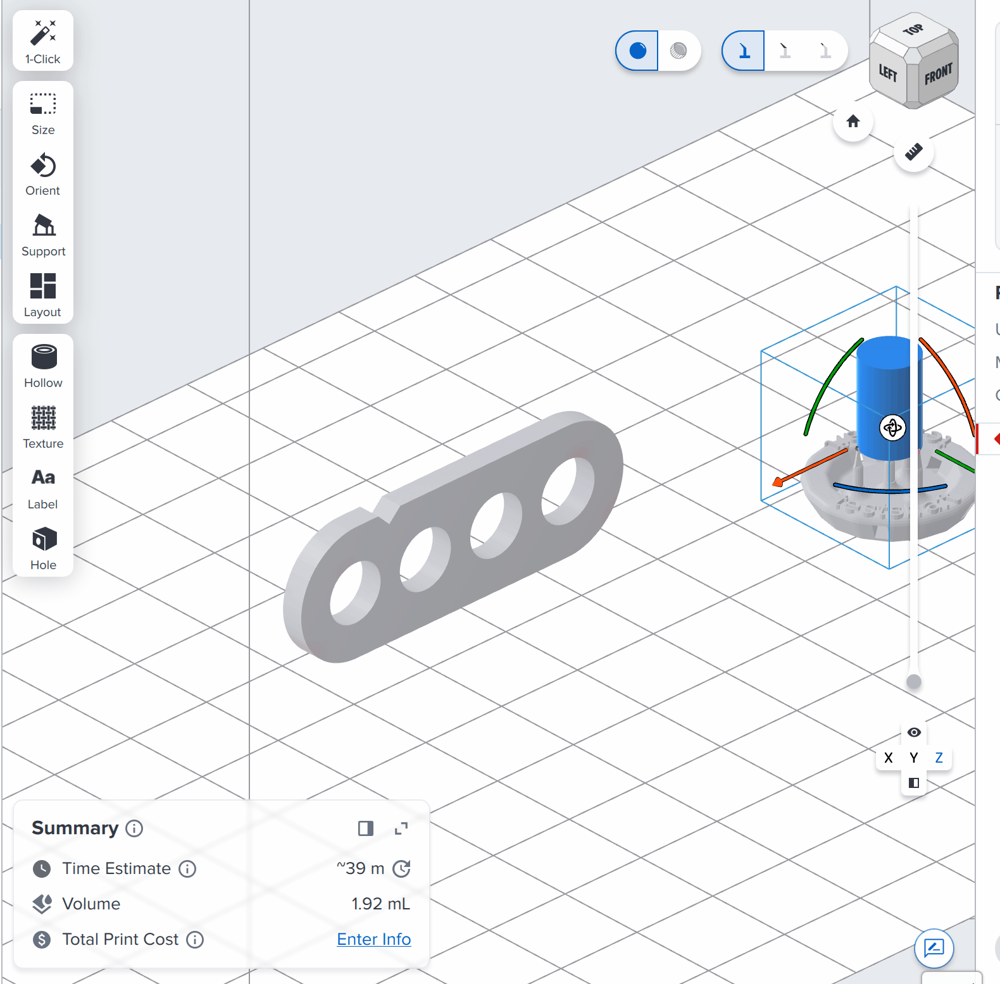
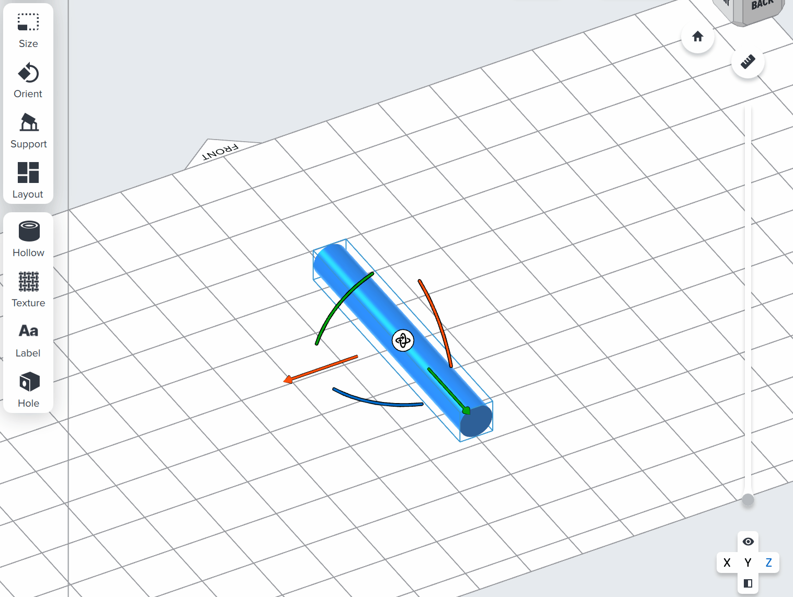
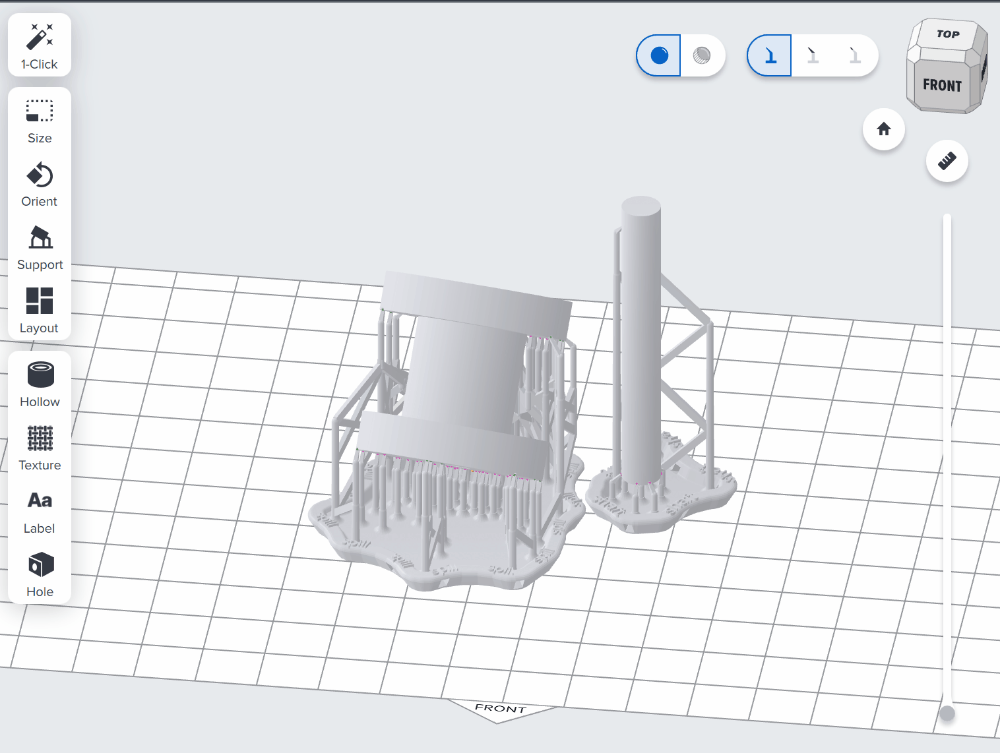

# NOTE TO TA: I lost my caliper so I am wait for amazon to deliver a new one this Saturday. 

# A10 – Lead Screw Translating System

## Research and Planning 
### RC 2 Fit
According to the Machinery’s Handbook, “RC 2 Sliding fits are intended for accurate location, but with greater maximum clearance than class RC 1. Parts made to this fit move and turn easily but are not intended to run freely, and in the larger sizes may seize with small temperature changes.” RC 2 fits are used to allow two parts to move against each other without getting stuck, but keeping them close enough together that they don't wobble around excessively. In other words, you should be able to push and pull the shaft without it getting stuck, the shaft doesn't move sideways and wobble inside the hole, and you don't want it shifting around unpredictably. [As an example, when needing to use drill bits inside guiding bushings](https://fliphtml5.com/cvloa/pdtx/Design_of_Jigs%2C_Fixtures_and_Press_Tools_%28_PDFDrive_%29/107/). The RC 2 fit, keeps the drill bit aligned with the intended drilling location, prevents the drill bit from wandering when it contacts the workpiece, maintains consistent hole positioning across multiple parts, and lastly reduces errors caused by operator movement or inaccurate positioning. If the clearance is too small, the drill bit may bind or experience excessive friction. If too large, the drill bit can shift, vibrate, and produce inaccurate holes. When given the accurate clearance, when the drill bit moves it will be supported well. Below is an example of a drill guide bushing. The chart for the RC 2 fits is seen below (albeit only diameter sizes that can be reasonable for this project:

### Limitations and My Design (Note to TA: Please Read Note at End of This Section)
This week was (and the following weeks ahead are) incredibly busy. Other classes and other projects in this class were taking a bunch of my time. Also, I had two seperate personal projects that had to be finished in an unknowable but short amount of time otherwise I could have been locked out from doing them forever, so I did not want to take chances and put more focus into them. For that reason I had very little time to do this project. By the time I was able to do it, I realized that everyone was using the machines at the same time. This then became apparent that I likely only had one shot at printing my parts, if it failed, there was a very real possibility there would not be enough printers left for me to finish on time. For those reasons, I was ironically forced on an assignment that required more creativity to make a much simpler design than my previous projects in this course. To not screw others over and to not make any mistakes that would ruin the print, I needed to make something that would not be massively affected by using the lowest quality but fastest settings (such as .1mm layer heights). This led me to the idea of making a spool that can be used for fishing lines. Essentially, a fishing wire can be wrapped around it to store it without making a mess, but due to the RC 2 fit, the spool itself can be rotated to quickly wrap the line around it without having to wrap the wire itself. This would also do the opposite affect when pulling some line to use quickly, where I didn't have to unravel it slowly. Due to all surfaces being parallel and circular, I thought that it may be possible for me to side step having to put them at an angle that may worsen shaft and hole tolerances that a .1mm layer height may cause with stepping (later I further thought this was possible when my coupon succeeded without a hitch). For my choice of hole and shaft diameter, I needed a balance that would give me a low print time but also a decently large RC 2 clearance (since larger diameters gave larger clearances). Looking at the chart, I decided on .25 inches since it was right at the smaller side of the .24in - .40in row of the RC 2 chart. This would give me clearance gap (in thousandths of an inch) of .2 to .85. Below is the general design I was going for followed by the section of the previous RC chart for a .25 inch diameter. 

NOTE TO TA: I felt that this simple design would anger the teacher and cause my grade for this assignment to take a hit. However, when I mentioned this to him when I showed him the result the class day it was due, he did not care and implied it was fine. If you disagree or don't believe me, please ask him yourself before you take points off.

### Issues Using the Machinery’s Handbook
A major problem with using the handbook for creating fits is that this section of the book was made specifically for metal and at specific manufacturing grades. Additive manufacturing like FDM and SLA (which is used for this project) have far worse tolerances then the Grades 5 and 6 (like Broaching) manufacturing quality used in the above chart. This is were I think things should be made more clear in the class for the future, but from my understanding (and what I used for this project) is that the clearance gap shown in the image above is the standard range for RC 2 fits no matter the manufacturing process. However, the tolerance limit ranges listed can not be used for all types of manufacturing. It can be possible to use a grade chart a couple pages before in the handbook to add/subtract dimensions to the grade to account for this, however it is again for metal manufacturing. SLA is drastically more variable in dimensional accuracy, so simply finding what specific grade it follows is not a good option. 

Actually, it may be possible to use Turning, shown in the book, as a somewhat comparable situation. Turning's grade ranges is from 7 to 13, this is pretty massive gap. What this likely means, is that there are a variety of variables in turning that need to be accounted a for to know what grade of turning their setup even has. That can includes, but not limited to, the specific machine, tooling, material, and setup used. SLA is even worse than that. Now in addition to its horrid dimensional accuracy, it has to be taken further into account printing issues like cupping or layer stepping and how curing a finished print further changes dimensional accuracy. When reading how to take these and the mentioned shrinking or expansion of the resin prints into account, it was clearly explained that there is not really a one size fits all grade or tolerances to choose from. The only way to figure it out was to do test prints like a coupon. 

SHRINKING AND EXPANSION
SHRINKING AND EXPANSION
SHRINKING AND EXPANSION
SHRINKING AND EXPANSION
SHRINKING AND EXPANSION
SHRINKING AND EXPANSION

In order to find a idea of the range for the right fit, I decided to make a "coupon" test find what was needed.

## Coupon Test
### Setup
While talking with another student, they found that the 10 thou gap was a bit tight, so after discussing with some other students, I decided on starting the coupon with a 12 thou clearance. This seems to be way above the .2 to .85 thou gap recommended by the Handbook, however it seems that the dimensional accuracy of the the SLA printer is very off. Additionally, a website I found (which I genuinely lost, can not remember what I searched to find it, but doesn't matter since it was very wrong) recommended a 20 thou clearance gap for the fit. In the end, I decided to have the coupon have 12, 15, 20, and 25 thou clearances and to work form there (which was unnecessary as will be shown). Personally, at this point I had some doubts so I expected to be doing another test, however, the results were interesting. For the the testing shaft, I left the dimension .25 inches like the shaft I actually will use for the final print. I did this to keep a constant to work around instead of having to work with two varying dimensions. 

### CAD Creation
#### Coupon
##### Base 
To create the base of the coupon, I started by creating the four holes adding 12, 15, 20, and 25 thou to their respective .25 inch diameters. I aligned them vertically from their centers, and gave them .10 inch gaps between them  Then I built a rectangle around it, but enusring every circle had a minimum of .15 inch from the sides of the rectangle. Done so by having three sides of the rectangle being .15 inch from each side of the .275 inch circle and the last side from the .252 inch circle. Then I extruded it to .10 inches. The reason for the low amount of circles tested and the thinness of the coupon was to reduce time of the print as much as possible so others could use the machine.

Then I filleted the edges to further reduce the print time (based around keeping a .15 inch gap around the larger circle).

Lastly I cut a little triangle at one section to indicate which hole was what.

#### Testing Shaft
Extremely simple, I just created a .25 inch diameter circle and extruded it to .4 inch.

### Prefrom 
Then I imported these models in Preform. A lot of people needed to make last minute prints, so I set the layer height to .1mm to reduce the time as much as possible. Due to .1mm layers, that meant I would likely face layer stepping on the holes and shaft which I thought could affect the results. So instead of using the 1-click button, I decided to lay their flat sides parallel to the surface of the bed, and then auto generate the supports and layout. This would also further reduce the amount of printing time of the coupon itself due to the z axis having the biggest impact on print time.

### Printing
To print, I used the HallowedDodo Form 4 printer. The print was luckily a success and taking off the supports was super easy. The only issue with the print was that the flat side that "laid flat" on the bed had a bit of a rough surface finish, but it didn't seem to affect any results.

### Testing
Immediately, I jumped right into testing by simply inserting the shaft and twisting it around in each hole. Instantly, it became obvious that the 12 though clearance was by far the best one. It was able to spin freely like the others, but it had a much rougher time running freely along the shaft. Without measuring, it was clear I could actually decrease the clearance gap further for a better result.  

### Measuring
When measuring, I was greatly surprised to find that the shaft was only a thou away from being exactly .25 inches. Ignoring the other holes since they were clearly unnecessary, I measured the 12 thou clearance hole to be ____. Possibly, solid cylindrical shafts have a lower tolerances than a hole for SLA? Either way this gave a clearance gap of ____. (when I tested weeks ago it was slightly above .85 thou, though I will try again once I get the caliper).

## Project CAD Design

### Creating the Spool
#### Parameters
In order to design a spool that would be able to easily control its dimensions, I setup the design that would allow easy edits using the below parameters. Finding the right size and thickness I wanted to ensure what I felt to be a rigid spool, I actually used the parameters a lot to try different combinations of thickness, size, and shaping. Additionally, I used it to allow easy modification of the clearance as well.

#### Creating the General Shape
To create the first part of the spool, I essentially created a cylinder. I set its outer diameter to the "outer_diameter" parameter and the length to the "thick" variable. In the end I set them to 1.2 in and 1.15 in respectively. The later of which to compensate for the "flanges" of the spool and giving enough room for a lot of fishing lines. 

#### Slot for the Fishing Lines
##### Creating a Center Plane
To make the model more easy to control just through the parameters, my idea was to cut out the section for the fishing line and flanges was to create a center plane and then cut extrude from that plane two concentric circles. To create the plane I essentially used the reference geometry tool in SolidWorks to select both flat sides of the cylinder, this created the center plane I needed 

##### Sketching the Outline of Cut
To create the cut, I simply created a sketch on the plane I just made sketch two concentric circles at the center axis of the cylinder. The larger one matching the outer diameter I decided on, and the smaller equaling the "inner_diameter" variable I created. In the end I decided on the .7in diameter since it gave the inner hollow cylinder strength and allowed the flanges to stick out enough for a large amount of wire. 

##### Cutting
To cut out the slot, I simply cut extrude from both sides at the distanced determined by the variable "cut" which equals the length of the spool minus the desired thickness of both of the flanges I wanted equal, which were set to the variable "flange_thick". Since the flanges could face issues from bending since they stick out, I chose the make them .25 inches thick to ensure they wouldn't break. This in return meant the slot was cut out at .65 inches.

#### Creating the RC 2 Fit Hole
To create the hole, I simply created a circle at the center one flat end of the spool, and then extrude cut it all the way through the spool. 
"shaft_diameter" equaled the nominal diameter of the shaft, while the "clearance" gave the add clearance gap I wanted based on the coupon testing I did. The "hole_diameter" variable simply added these two together which I used for the hole I cut. Initially, I actually wanted to reduce the clearance gap to 10 thou since the coupon was right on the money for the clearance range. However, I went against my judgment after discussing it with other students. As explained later, I additional added another thou to it, bring it up to a 13 thou clearance, out of fear of the stepping from the SLA would affect the tolerances. In a strange twist of events, I ended up being right AND wrong about going against my belief that 10 thou would have been better

### Creating the Shaft
Creating the shaft was as easy as the test shaft I made for the coupon. Since leaving the test shaft at .25 inches was so successful to treat it at the nominal size and as a "constant", while taking into account that the coupon test was based on this diameter, I decided to stick with leaving the shaft at the nominal size. For the length, I wanted to give enough so that I could hold the shaft from both sides without touching the spool while also being able to shake it a bit to see how well the RC 2 fit came out. For that reason, I settled on the shaft being able to stick out .4 inches out of each side of the spool. Adding these lengths plus the length of the spool was 1.95inches, I decide I would just make it 2inches to keep it simply meaning they will stick out .425 inch instead.

### Final Assembly
In the end, the CAD files worked out well giving the following assembly. Again, this does seem to be rather simple, but the professor seemed to not care at the time.
##### Normal Assembly
Notice the clearance gap in the model.

##### Exploded Assembly

### Quick Summary
So to sum up, my nominal size for the hole and shaft was .25 inches. I decided on .25 inches since it was right at the smaller side of the .24in - .40in row of the RC 2 chart. This would give me clearance gap (in thousandths of an inch) of .2 to .85. I needed a balance that would give me a low print time but also a decently large RC 2 clearance (since larger diameters gave larger clearances) to make it easier to succeed in falling in the range. To take into account for potential printing or curing variation and the actual tolerances I needed for the Form 4 SLA, I simply created a coupon to find what clearance gap I should shoot for. To "lessen" the amount of variables that I needed to take into account for, I simply left the shaft at the nominal diameter the same way I did with the coupon. As explained later, I ended up setting the tolerance/clearance to 13 thou instead of the 12 thou I got from the coupon, out of fear that printing at an angle for the spool would hurt the clearances.

## Preprocessing
### Machine Name
I used the HiddenCod form 4 printer in the FabLab
### Build Orentation and Supports
#### Shaft
For the shaft, I did the same thing as the test shaft, where I set it vertically so that there were not be any layer stepping along its length. Again, it was to try and reduce any possible issues with it affecting the clearance, and for this time, to stay consistent with the coupon test. Therefore, instead of using the 1-click button, I decided to lay one flat side of the shaft parallel to the surface of the bed, and then auto generate the supports (and later the layout). We were not expected to know how to apply these strange supports, so we were told to just keep them at the defaults and auto generate them.

#### Spool
Originally, I was going to set the spool  vertical as well, however, the PreForm told me that the hole would face cupping issues if I did it this way. 

This threw an unknown variable into my print that worried me. Cupping can have a serious impact on the internal surface of the hole, resulting in a whole range of issues from poor surface finish to deformations to it even rupturing. That meant I had to use the 1 click tool to try and find an orientation that would not cause cupping. Which in return meant I now had to put it at an angle. Since, as will be explained in a second, I had to set the layer height to .1mm, that meant that some stepping could occur and affect the clearance. It is for that reason that I decided to change the hole tolerance from 12 thou to 13 thou. At this point, I ran the 1-click several times, trying to find an orientation that gave the smallest angle possible while still being close to the 20mL limit as possible. This surprisingly took a bit longer than you might think since it seemed to be random, sometimes even setting it 20 degrees from the bed surface. Eventually, I did find an acceptable orientation. Below is one example of the the 1-click setup, I will show the actual 1-click print I decided on at the end of the Layer Height/Print Time/Volume section. For whatever reason the shaft also changed as well, so I had to reset it up after I found what I wanted.

### Layout
Once I found the right orientations and support, I selected both parts and used the auto layout feature. I personally do not know how to correctly orientate on an SLA, I used this feature as a substitute for my lack of knowledge. This was recommended anyways so I it is not a big deal. 

### Layer Height, Print Time, and Volume
Finally, I had to decide on the layer height. During the time I was to print my parts, everyone decided to show up at the same time. At this point, I was also running out of time to be able to stay there because I had to rush home to finish the project I didn't have clear knowledge when it would expire. So when I asked around if anyone was immediately ready to print together, no one would not have been able to for at least another 20 minutes which is time I didn't have. At this point, I was there for so long, I had to ask one of the workers if he could put my parts in the wash/cure and take the pictures for me so that I could leave on time (which he had no problem helping me with). That meant that I could not wait for others, so I had to bite the bullet and put it at .1mm layer height so that I did not hog the machine and people would be able to use it quickly. The problem is, I was forced to put the spool at an angle to not allow cupping, and I had no idea or time to figure out how this .1mm stepping would impact the clearance. This is exactly when I rushed through the entire process again putting the clearance now at 13 thou. After running everything for the last time, I was met with a 1 hour and 21 minute print time and a 20.85 mL volume. I hope you can understand that I did not have the time to figure out how to lower the build volume by a very small .85 mL volume. I think this is perfectly acceptable considering that just makes a 9.4mm sided cube, not even the size of a lego.

## Post-Processing
Thanks again to the help from the FabLab worker to help me with this section
### Finished Print
The print came out a success with no noticeable issues.

### Support Removal
This is my fault for not being their, but the worker forgot to take pictures of this section. I hope the fact that I did show it for the coupon can make up for this. He instead took a picture right before he took it off the bed.

### Wash 
Immediately after it finished, we put it in the wash for 15 minutes.

### Curing
Curing was set to 30 minutes, but I later learned that clear should use a max of 15 (maybe not even necessary) but I didn't notice any poor results because of it.

### Surface Finish, Accuracy and Deformations
Overall, the print came out ok. The print appears to have come out with the same shapes I wanted it to meaning in general it was accurate. There seems to be no extreme deformations looking at it, as the shaft doesn't look bent at all and the shaft goes into the hole with resistance that feels like the spool bent internally. The shafts surface looked incredible right after curing, even after a while it looks really smooth and the flat sides of it are perfect with no noticeable issues by some miracle. However, the spool didn't come out as well. As seen below, the stepping is very noticeable on the sections that had no supports. For the sides that had supports, the surface is very rough and bumpy, with an obviously poor quality surface finish and slight deformations. It appears larger objects may have a harder time with printing long sides parallel to the printing bed. Keep in mind below that the pictures are after a ton of testing and then playing around with the spool.

## Fit Test

### Does it slide smoothly but locate accurately?

## Lessons Learned 
### What challenges arose in achieving the RC 2 fit?
The biggest challenge was that there are an immense amount of variables with SLA to take in consideration when trying to have consistent, universal clearances for sliding fits. As in, it is heavily dependent on the machine used and how it was calibrated; the material used, the way and time post-processing was done; how the print was orientated, and so on and so fourth that might affect tolerances and therefore clearances. This meant that the only way to get within the clearance gap range was to take extra time to create a test coupon, try to orientate the actual print as close as possible to the test, and then use the same printer as the test and hope it comes out similarly. So essentially, the challenge is that you need to calibrate to your specific setup, and possibly recalibrate everytime a change is made, in order to get accurate fits.

### Did surface roughness, printer calibration, or curing affect the fit?
As just stated, printer calibration is one of the main factors that will affect a fit. If you try to use the same exact hole and shaft with the same clearances found for one printer, you will get a varying end result when you try to use it for another. Every printer and calibration will have its unique flaws and uncertainties. Furthermore, it goes without saying that a poorly calibrated and unkept machine will have way more issues with dimensional accuracy than the opposite setup. 

For surface finish, I cannot accurately give a statement because I am unable to measure the hole all the way through, but I do think that the fact there was stepping from the spool being angled had a slight affect on the fits. From a proxy, when touching the smooth parts of the spool and then the stepping on the top of it, I can clearly feel a big difference. The stepping very obviously has more friction. Then just by looking at it with a naked eye, you can see the stepping, this certainly means there is an affect on the dimensional accuracy that was not accounted for in the coupon test. These will have an affect on the fit, but how much can be very little or noticeable.

Curing will always have an affect because_________________________________________
SHRINKING AND EXPANSION
SHRINKING AND EXPANSION

### How could you improve accuracy next time?
One way to improve accuracy is to essentially measure the fits from this part with a specialized tool, and try to adjust a second iteration with this data (possibly repeating this). However, this might require trying to have the same setup over and over again if it has a large enough impact on this (ie angles orientation and machine calibrations). You could also just orientate the coupon I created, but it is likely better to do it with the model that was created.

### Time Spent
Creating the model and printing it took 7 hours and writing this report took 10 hours. 

### Resources
#### Physical
1. Clear V5 Resin
2. HiddenCod Printer
3. Calipers
4. Cellphone

#### Software
1. SolidWorks
2. PreForm
3. ScreenToGif

#### Books, Websites, and Images
1. Machinery’s Handbook
2. Drill Image - https://fliphtml5.com/cvloa/pdtx/Design_of_Jigs%2C_Fixtures_and_Press_Tools_%28_PDFDrive_%29/107/
3. 
